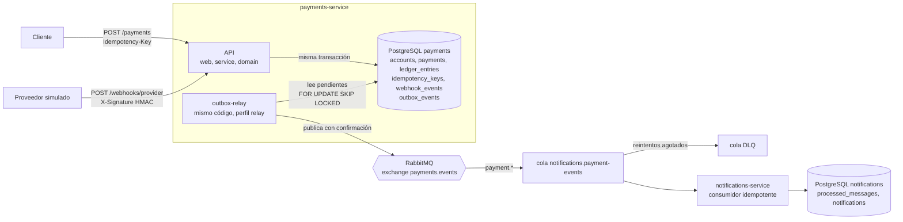
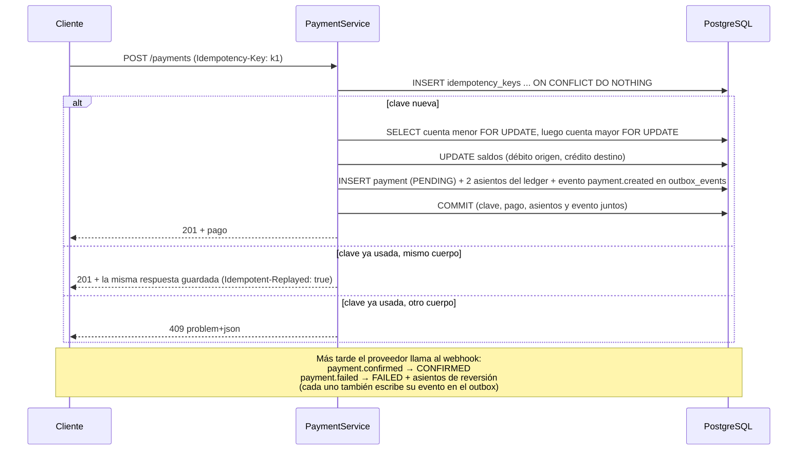
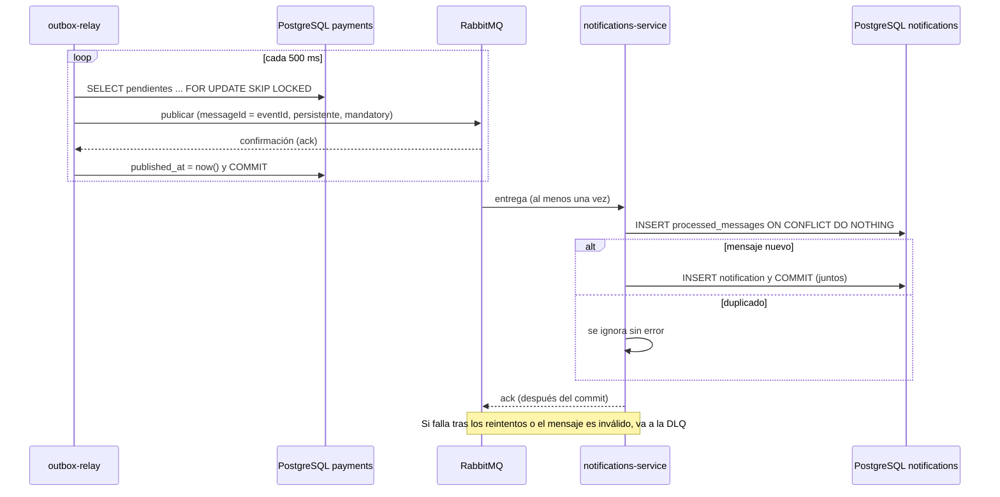

# payments-service

[](https://github.com/Frandercc1234/payments-service/actions/workflows/ci.yml)

> **English summary.** A portfolio-grade payments backend built with Java 21, Spring Boot 3.5, PostgreSQL, Flyway and
> RabbitMQ. It models accounts with balances in CRC/USD (integer cents, never floating point), creates payments through an
> **idempotent** `POST /payments` (`Idempotency-Key` header), records every movement in an append-only **double-entry
> ledger** (debits and credits always net to zero), prevents overdrafts under concurrency with **pessimistic row locks**
> (50 parallel payments against a balance for 10 → exactly 10 accepted), and processes a simulated provider **webhook**
> verified with **HMAC-SHA256** (constant-time comparison, replays have no effect). Payment events reach a second
> microservice, **notifications-service**, through the **transactional outbox** pattern: the event is written in the same
> database transaction as the payment, a separate **relay** process publishes it to **RabbitMQ** (publisher confirms,
> at-least-once), and the consumer is **idempotent** (a redelivered message never notifies twice; poison messages go to a
> dead-letter queue). Errors follow RFC 7807. Everything is tested against real PostgreSQL and RabbitMQ with Testcontainers,
> starts with a single `docker compose up`, and is built, tested and smoke-tested end to end on every push with GitHub Actions.
> **It is a portfolio project: the payment provider is simulated, notifications are simulated, and no real money is involved**
> — see [Límites](#límites).

## Qué resuelve

Los sistemas de pago fallan de formas muy específicas: un cliente reintenta una petición por un corte de red y se cobra
dos veces, dos pagos simultáneos gastan el mismo saldo, un proveedor reenvía una confirmación, alguien falsifica un
webhook, la aplicación se cae justo entre guardar el pago y avisar a otro servicio. Este proyecto es una implementación pequeña
y verificable de las defensas contra cada uno de esos problemas:

| Problema | Defensa | Cómo se prueba |
|---|---|---|
| Reintento del cliente cobra dos veces | `Idempotency-Key` + clave única en PostgreSQL | misma clave: mismo resultado; otro cuerpo: 409; 10 peticiones simultáneas: un solo cobro |
| Dos pagos gastan el mismo saldo | `SELECT … FOR UPDATE` (`PESSIMISTIC_WRITE`) | 50 pagos en paralelo contra saldo para 10: exactamente 10 aceptados, saldo ≥ 0 |
| Pagos cruzados A→B y B→A se bloquean entre sí | bloqueo de cuentas en orden fijo de ID | 40 pagos opuestos simultáneos sin deadlocks |
| Dinero que "aparece" o "desaparece" | libro mayor de doble entrada, solo se agregan filas | suma de débitos y créditos = 0, por pago y global |
| Webhook falsificado o alterado | HMAC-SHA256 sobre el cuerpo crudo, comparación en tiempo constante | firma válida, inválida, ausente, malformada, de otro secreto, cuerpo alterado |
| Proveedor reenvía un evento | tabla de eventos con `event_id` único | reenvío (y 10 simultáneos) no cambia nada |
| Estados imposibles (`FAILED` → `CONFIRMED`) | máquina de estados en el dominio | transiciones válidas e inválidas, también vía webhook |
| El pago se guarda pero el aviso a otro servicio se pierde (o al revés) | **outbox transaccional**: el evento va en la misma transacción que el pago | si el evento no se puede escribir, el pago hace rollback; un rechazo no deja evento |
| RabbitMQ caído | un proceso aparte (relay) publica; la API nunca habla con el broker | con el broker detenido `POST /payments` sigue dando 201 y el evento sale al volver |
| Evento publicado dos veces | consumidor idempotente (`processed_messages` + restricción única) | mismo mensaje dos veces y 10 copias simultáneas: una sola notificación |
| Mensaje que nunca podrá procesarse | reintentos acotados y cola de mensajes muertos (DLQ) | JSON ilegible, sin `messageId`, versión desconocida → DLQ |
| Dos relays publican el mismo evento | bloqueo de filas (`FOR UPDATE SKIP LOCKED`) | dos relays simultáneos: cada evento sale exactamente una vez |

## Stack

| Capa | Tecnología |
|---|---|
| Lenguaje y framework | Java 21, Spring Boot 3.5 (Web, Data JPA, Validation, Actuator) |
| Base de datos | PostgreSQL 16 (una base por servicio) + Flyway para las migraciones |
| **Mensajería** | **RabbitMQ 3.13 (Spring AMQP): exchange `topic`, confirmaciones del publicador, DLQ** |
| API docs | springdoc-openapi (Swagger UI) en `payments-service` |
| Pruebas | JUnit 5, Mockito, Testcontainers (PostgreSQL y RabbitMQ reales), Awaitility |
| Operación | Docker, Docker Compose, GitHub Actions |

## Arquitectura

Dos servicios, dos bases de datos, un broker. No comparten código ni tablas: solo el **contrato del evento** (ver más abajo).



Flujo de un pago (todo dentro de **una** transacción, incluido el evento del outbox):



Del pago a la notificación (el outbox, el relay y el consumidor):



### El contrato del evento (versión 1)

`payments-service` publica en el exchange `payments.events` con la clave de enrutamiento `payment.created`, `payment.confirmed`
o `payment.failed`. El `messageId` de AMQP es el `eventId`, y es lo que el consumidor usa para descartar duplicados.

```json
{
  "eventId": "0b5f…",
  "version": 1,
  "type": "payment.created",
  "occurredAt": "2026-11-19T18:00:00Z",
  "payment": {
    "id": "…", "sourceAccountId": "…", "destinationAccountId": "…",
    "amount": 25000, "currency": "CRC", "status": "PENDING"
  }
}
```

La cola `notifications.payment-events` (declarada por el consumidor, no por el productor) se enlaza al exchange con `payment.#`.
Los campos nuevos se pueden agregar sin romper al consumidor (los desconocidos se ignoran); un cambio incompatible exige subir `version`.

## Cómo correrlo

Requisitos: **Docker** (con Compose). Para compilar y probar en local: **JDK 21** (cada servicio trae su wrapper `mvnw`, que descarga Maven).

```bash
docker compose up --build
```

Levanta todo el sistema: PostgreSQL (con una base por servicio), RabbitMQ, la API, el relay del outbox y el servicio de notificaciones.
Cada servicio espera a que sus dependencias estén sanas, y Flyway crea los esquemas.

| Qué | Dónde |
|---|---|
| API de pagos (Swagger UI) | http://localhost:8080/swagger-ui.html |
| OpenAPI JSON | http://localhost:8080/v3/api-docs |
| Salud de la API (Actuator) | http://localhost:8080/actuator/health |
| Notificaciones de un pago | `http://localhost:8081/notifications?paymentId=<id>` |
| Salud de notificaciones | http://localhost:8081/actuator/health |
| Consola de RabbitMQ | http://localhost:15672 (usuario `payments`, contraseña `payments`) |

> Si ya habías levantado una versión anterior, recrear los volúmenes con `docker compose down -v`: el script que crea la base
> `notifications` solo se ejecuta la primera vez que PostgreSQL inicializa su volumen.

### Probarlo de punta a punta

```bash
./scripts/smoke-test.sh
```

Crea dos cuentas y un pago, espera la notificación `payment.created`, confirma el pago con un webhook firmado, espera la
notificación `payment.confirmed`, reenvía el mismo webhook y comprueba que **no** aparece una tercera. Es la misma prueba que corre el CI.

### Probarlo a mano

```bash
# 1) Dos cuentas (montos en CENTAVOS: 100000 = 1.000,00 CRC)
A=$(curl -s -X POST localhost:8080/accounts -H 'Content-Type: application/json' \
  -d '{"ownerName":"Ana","currency":"CRC","initialBalance":100000}' | sed -E 's/.*"id":"([^"]+)".*/\1/')
B=$(curl -s -X POST localhost:8080/accounts -H 'Content-Type: application/json' \
  -d '{"ownerName":"Beto","currency":"CRC","initialBalance":0}' | sed -E 's/.*"id":"([^"]+)".*/\1/')

# 2) Un pago idempotente: repetir este comando devuelve el MISMO pago y no vuelve a cobrar
curl -si -X POST localhost:8080/payments -H 'Content-Type: application/json' -H 'Idempotency-Key: demo-1' \
  -d "{\"sourceAccountId\":\"$A\",\"destinationAccountId\":\"$B\",\"amount\":25000,\"currency\":\"CRC\"}"

# 3) Confirmación del proveedor (simulado): firmar el cuerpo EXACTO con el secreto compartido
PAYMENT_ID=<id devuelto en el paso 2>
BODY="{\"eventId\":\"evt-1\",\"type\":\"payment.confirmed\",\"paymentId\":\"$PAYMENT_ID\"}"
SIG=$(printf '%s' "$BODY" | openssl dgst -sha256 -hmac "dev-only-secret-change-me" -hex | sed 's/^.* //')
curl -s -X POST localhost:8080/webhooks/provider -H 'Content-Type: application/json' \
  -H "X-Signature: sha256=$SIG" -d "$BODY"

# 4) Las notificaciones llegan solas (outbox -> relay -> RabbitMQ -> notifications-service)
curl -s "localhost:8081/notifications?paymentId=$PAYMENT_ID"
```

Los secretos de desarrollo vienen de `.env.example` (copiarlo a `.env` para cambiarlos; `.env` está ignorado por git).

### Pruebas

```bash
cd payments-service && ./mvnw verify        # 87 pruebas (PostgreSQL y RabbitMQ reales con Testcontainers; requiere Docker)
cd notifications-service && ./mvnw verify   # 9 pruebas (PostgreSQL y RabbitMQ reales)
```

| Tipo | Qué cubre |
|---|---|
| Unitarias de dominio | estados válidos/inválidos, montos positivos, saldo insuficiente, moneda distinta, desbordamiento de `long` |
| Integración (Testcontainers) | esquema y restricciones `CHECK` de la base, flujo de pago, ledger balanceado, formato de error, OpenAPI |
| Idempotencia | misma clave/mismo cuerpo, otro cuerpo (409), orden de campos JSON, clave ausente, intento fallido no consume la clave, 10 simultáneas |
| Concurrencia | 50 pagos en paralelo contra saldo para 10 (×5 repeticiones, con un hilo vigilando que el saldo nunca sea negativo); 40 pagos opuestos sin deadlock |
| Webhook | firma válida / inválida / ausente / malformada / de otro secreto / cuerpo alterado, reenvío, 10 entregas simultáneas, reversión, transiciones inválidas |
| Outbox | el evento se escribe con el pago; si el evento no se puede escribir (trigger que falla) el pago hace rollback; rechazos, repeticiones idempotentes y reenvíos de webhook no dejan eventos de más |
| Relay (RabbitMQ real) | publica y marca como publicado, respeta el orden, sin cola enlazada el evento queda pendiente y sale cuando aparece un consumidor, dos relays simultáneos publican cada evento una sola vez; con Mockito: nack, mensaje devuelto, sin confirmación y broker caído dejan el evento pendiente |
| Consumidor (RabbitMQ real) | notifica una vez aunque el mensaje llegue dos veces o diez a la vez, mensajes inválidos a la DLQ, un fallo al notificar deshace la reclamación y el mensaje se procesa al reentregarlo |
| De punta a punta (`smoke-test.sh`, también en CI) | pago → outbox → relay → RabbitMQ → notificación, y el webhook reenviado no duplica |

> Las pruebas críticas se validaron con **mutaciones**: al quitar `@Lock(PESSIMISTIC_WRITE)` fallan las 6 pruebas de concurrencia;
> al quitar el bloqueo de filas del relay falla la de dos relays; al romper el chequeo de duplicados del consumidor fallan sus pruebas.
> Es decir, detectan de verdad el defecto que dicen detectar.

## Endpoints

**payments-service** (`:8080`)

| Método y ruta | Descripción | Respuestas |
|---|---|---|
| `POST /accounts` | Abre una cuenta (`CRC` o `USD`, saldo inicial en centavos) | 201, 400 |
| `GET /accounts/{id}` | Consulta una cuenta | 200, 404 |
| `POST /payments` | Crea un pago. **Requiere** `Idempotency-Key` | 201, 400, 404, 409, 422 |
| `GET /payments/{id}` | Consulta un pago | 200, 404 |
| `POST /webhooks/provider` | Evento del proveedor. **Requiere** `X-Signature: sha256=<hex>` | 200 (`processed` / `duplicate`), 400, 401, 404, 409, 422 |

**notifications-service** (`:8081` en Compose)

| Método y ruta | Descripción | Respuestas |
|---|---|---|
| `GET /notifications?paymentId=` | Notificaciones de un pago, en orden de creación | 200, 400 |

Todos los errores salen como `application/problem+json` (RFC 7807) con `type`, `title`, `status` y `detail`
(más `errors[]` en validaciones). Ejemplo:

```json
{
  "type": "urn:payments:problem:insufficient-funds",
  "title": "Saldo insuficiente",
  "status": 422,
  "detail": "Saldo insuficiente en la cuenta 6f1c…"
}
```

## Decisiones clave

Cada decisión incluye la alternativa que se descartó y por qué.

1. **Montos como `long` en centavos.**
   *Descartado:* `double` (no representa 0,10 exactamente) y `BigDecimal` (correcto, pero innecesario si la unidad mínima es fija).
   Además Jackson se configura para **rechazar** `10.5` en un monto en lugar de truncarlo a `10` en silencio, y las sumas usan `Math.addExact`.

2. **Bloqueo pesimista de filas (`SELECT … FOR UPDATE`) y orden fijo de bloqueo.**
   *Descartado:* bloqueo optimista con `@Version` y reintentos. Es válido, pero bajo contención sobre una misma cuenta (el caso de las
   50 peticiones) produce una avalancha de reintentos; con bloqueo pesimista cada pago espera su turno y el resultado es determinista.
   Las cuentas se bloquean siempre por ID ascendente para que A→B y B→A no se bloqueen mutuamente (deadlock).

3. **Idempotencia respaldada por la base de datos.** La clave se reclama con `INSERT … ON CONFLICT DO NOTHING` en la misma transacción que crea el pago.
   *Descartado:* `if (existe) … else insertar` en Java (tiene una carrera entre el `SELECT` y el `INSERT`), una caché en memoria (se pierde al reiniciar y
   no funciona con varias instancias) y Redis (agrega una pieza de infraestructura que no hace falta). La huella del cuerpo se calcula sobre los campos
   interpretados, no sobre el texto, así que el orden de los campos JSON no importa. Un intento **fallido** hace rollback también de la clave: no queda consumida.

4. **Esquema con Flyway y `ddl-auto=validate`.** Las restricciones `CHECK (balance >= 0)`, `CHECK (amount > 0)` y las claves únicas viven en la base:
   son la última defensa aunque el código tuviera un bug.
   *Descartado:* `ddl-auto=update`, que modifica el esquema sin control de versiones ni revisión.

5. **Ledger de doble entrada de solo-agregar.** Cada pago escribe un débito y un crédito; una reversión escribe dos asientos nuevos (`REVERSAL`).
   *Descartado:* actualizar o borrar filas para "deshacer" un pago, que destruye la trazabilidad.

6. **Webhook: HMAC-SHA256 sobre los bytes crudos del cuerpo, comparación en tiempo constante y firma verificada antes de interpretar nada.**
   *Descartado:* deserializar a objeto y volver a serializar para firmar (cualquier diferencia de espacios o de orden invalida una firma legítima) y comparar con `equals`
   (el tiempo de respuesta delata cuántos bytes coinciden).

7. **El dinero se mueve al crear el pago (queda `PENDING`); el proveedor confirma o rechaza después.** Un rechazo revierte con asientos compensatorios.
   *Descartado:* mover el dinero solo al confirmar, que obligaría a modelar reservas/retenciones (*holds*) y complicaría el requisito de que cada pago produzca su débito y crédito.
   El costo de esta decisión está explicado en [Límites](#límites).

8. **Arquitectura por capas simples (`web → service → repository`, con `domain`), con la dependencia en un solo sentido.**
   El servicio recibe comandos propios (`CreatePaymentCommand`, `ProviderEventCommand`) y devuelve sus propios resultados; el controlador hace el mapeo.
   *Descartado:* arquitectura hexagonal completa (para este tamaño agrega ceremonia sin beneficio visible) y dejar que los servicios importen los DTO web
   (así estaba al principio: cambiar el contrato HTTP obligaba a tocar la lógica de negocio). Un compromiso consciente: las entidades JPA viven en `domain`
   en lugar de duplicarse en un modelo de dominio puro más uno de persistencia.

9. **Pruebas contra PostgreSQL y RabbitMQ reales con Testcontainers.**
   *Descartado:* H2 en memoria y un broker simulado. No implementan igual `FOR UPDATE`, `ON CONFLICT`, los niveles de aislamiento ni las confirmaciones del publicador,
   justo lo que se quiere probar.

10. **Outbox transaccional para publicar eventos.** El evento se escribe en la misma transacción que el pago; un proceso aparte lo publica.
    *Descartado:* publicar a RabbitMQ dentro del `POST /payments` (si el broker cae o la aplicación muere entre el `COMMIT` y la publicación, el pago existe y nadie se entera, o se
    avisa de un pago que luego hizo rollback; no hay transacción que abarque la base y el broker), publicar después del commit con un `@TransactionalEventListener` (mismo
    hueco: la caída entre el commit y la publicación pierde el evento), y CDC con Debezium (resuelve lo mismo, pero suma Kafka Connect: demasiada infraestructura para este alcance).

11. **El relay es un proceso aparte (la misma imagen con el perfil `relay`, sin servidor web).**
    *Descartado:* un hilo `@Scheduled` dentro de la API. Es más simple, pero acopla la disponibilidad de la API al broker y no es un proceso independiente. Con el diseño actual la API
    **nunca** habla con RabbitMQ: un broker caído no afecta a los pagos (verificado deteniendo el contenedor).

12. **Publicación fiable: confirmaciones del publicador + `mandatory` + marcar como publicado solo después de la confirmación + `SKIP LOCKED`.**
    La garantía es **al menos una vez**: si el relay muere entre publicar y confirmar en la base, el evento sale otra vez. Si ninguna cola recibe el evento, el broker lo devuelve y queda pendiente
    en vez de perderse en silencio. `FOR UPDATE SKIP LOCKED` deja que varios relays trabajen sin pisarse.
    *Descartado:* "exactamente una vez" (no existe entre dos sistemas sin una transacción distribuida; se aproxima con al-menos-una-vez más un consumidor idempotente).

13. **Consumidor idempotente: reclamar el `messageId` y crear la notificación en una sola transacción, y confirmar (ack) después del commit.**
    *Descartado:* confirmar antes de procesar (si el proceso muere se pierde el mensaje) y deduplicar solo en memoria (se pierde al reiniciar y no sirve con varias instancias).
    La restricción única de la base es la defensa final; las pruebas comprueban además que un duplicado se ignora en silencio y no termina en la DLQ.

14. **Mensajes que no se pueden procesar van a una cola de mensajes muertos (DLQ) tras reintentos acotados.**
    *Descartado:* reencolar sin límite (un mensaje envenenado bloquearía la cola para siempre) y descartar en silencio (se perdería sin dejar rastro).

15. **Dos servicios con una base de datos por servicio y sin código compartido.**
    *Descartado:* compartir una librería de DTO entre servicios (los acopla en compilación y despliegue: justo lo que los microservicios quieren evitar) y usar una sola base
    (acoplaría los servicios por sus tablas). Cada uno tiene su copia del contrato y tolera campos nuevos.

16. **RabbitMQ como broker.**
    *Descartado:* Kafka (un registro de eventos distribuido es más de lo que pide un flujo de notificaciones de bajo volumen y pide más infraestructura) y colas dentro de PostgreSQL
    (sin enrutamiento ni DLQ nativos).

## Límites

Esto es un **proyecto de portafolio**, no un sistema listo para producción. Sin rodeos:

- **El proveedor de pagos es simulado.** El "proveedor" es un cliente que firma con un secreto compartido. **No hay dinero real**, ni tarjetas, ni cumplimiento PCI-DSS, ni conciliación bancaria.
- **Las notificaciones son simuladas.** El servicio solo guarda un registro con canal `LOG`; no envía correos, SMS ni notificaciones push.
- **No hay autenticación ni autorización**, ni entre cliente y API ni entre servicios. Cualquiera puede crear cuentas y pagar desde cualquier cuenta. Las claves de idempotencia no están ligadas a un cliente.
- **La reversión necesita fondos en el destino.** Como el dinero se mueve al crear el pago, si el destino ya lo gastó, un `payment.failed` responde 422 y el pago sigue `PENDING`
  (nada queda a medias y el proveedor puede reintentar). Un sistema real modelaría retenciones (*holds*), saldos disponibles vs. contables o un proceso de recuperación (*clawback*).
- **Sin conversión de monedas.** Un pago solo ocurre entre cuentas de la misma moneda (`CRC` o `USD`); lo contrario responde 422.
- **Webhook sin protección contra reenvío por tiempo.** Los duplicados se detectan por `eventId`, pero no hay marca de tiempo firmada ni rotación de secretos.
- **Las claves de idempotencia nunca caducan** (no hay TTL ni limpieza) y solo se guardan los resultados exitosos.
- **El ledger es de solo-agregar por convención del código**, no por permisos de la base (no hay triggers ni un rol de base de datos sin `UPDATE`/`DELETE`).
- **Mensajería: garantía "al menos una vez" y sin orden global.** El relay publica en orden de creación y se detiene en el primer fallo, pero los reintentos y varios consumidores en paralelo
  pueden entregar eventos de distintos pagos (e incluso del mismo) fuera de orden; el consumidor actual no depende del orden, otro podría hacerlo.
- **El outbox y la tabla `processed_messages` no se purgan.** Las filas ya publicadas se quedan para siempre; un sistema real las archivaría o borraría pasado un plazo.
- **El relay consulta la base cada 500 ms** (*polling*): agrega latencia de hasta ese intervalo y una consulta constante aunque no haya eventos. La alternativa sería CDC.
- **Los reintentos del consumidor no distinguen errores.** Un mensaje envenenado también se reintenta 3 veces antes de ir a la DLQ (con retardo creciente); podría clasificarse
  para ir directo a la DLQ. Tampoco hay herramienta para reprocesar mensajes desde la DLQ: se inspeccionan a mano desde la consola de RabbitMQ.
- **Un solo nodo de RabbitMQ y un solo PostgreSQL**, sin réplicas ni alta disponibilidad. El contrato del evento no tiene pruebas de contrato entre servicios (cada uno prueba su copia).
- **Escalabilidad no demostrada.** El bloqueo por fila serializa los pagos de una misma cuenta (una cuenta muy activa es un cuello de botella). Las pruebas de concurrencia corren contra una sola
  instancia de la aplicación; con varias instancias la corrección se apoya en la base de datos, pero eso no está probado aquí.
- **Observabilidad mínima:** solo `/actuator/health`; sin métricas, trazas distribuidas entre servicios ni limitación de tasa (*rate limiting*).
- **Configuración de desarrollo:** `docker-compose.yml` expone PostgreSQL y RabbitMQ con contraseñas por defecto y el secreto del webhook tiene un valor de desarrollo. No usar así fuera de una máquina local.
- **Versión de Spring Boot:** el proyecto usa Spring Boot **3.5.16**, la última línea 3.x, tal como se pidió. Spring Initializr ya solo ofrece la línea 4.x, así que migrar es el siguiente paso natural.
- **No hay listados ni paginación**, ni historial de cuentas, ni endpoint para consultar el ledger (se verifica en las pruebas con SQL).
- Los tres diagramas Mermaid los compilé y revisé a ojo con Mermaid 11 fuera de GitHub (sin errores de sintaxis); en la página de GitHub se generan sus contenedores sin mensaje de error, pero no vi allí el dibujo final.

## Estructura

```
docker-compose.yml                 orquesta todo: PostgreSQL, RabbitMQ, API, relay y notificaciones
.env.example                       valores de desarrollo
docker/postgres/                   script que crea la base "notifications" (una base por servicio)
scripts/smoke-test.sh              prueba de punta a punta (también corre en CI)
docs/guia-de-estudio.md            guía para entender y explicar cada pieza (con comparación con NestJS)
payments-service/                  proyecto Maven independiente (Dockerfile y mvnw propios)
  src/main/java/cr/portfolio/payments/
    domain/       Money, Account, Payment, PaymentStatus, LedgerEntry, OutboxEvent, … (reglas de negocio)
    repository/   interfaces de Spring Data JPA (+ consultas con bloqueo)
    service/      PaymentService, IdempotentPaymentService, WebhookService, OutboxService, OutboxPublisher, AccountLocks, SignatureVerifier
    web/          controllers, DTOs, WebhookRequestReader y ApiExceptionHandler (ProblemDetail)
    config/       propiedades del webhook y del outbox, OpenAPI, exchange de RabbitMQ
  src/main/resources/db/migration/   migraciones Flyway (V1 esquema, V2 outbox)
  src/test/java/…                    pruebas unitarias y de integración (Testcontainers)
notifications-service/             segundo proyecto Maven, independiente
  src/main/java/cr/portfolio/notifications/
    messaging/    PaymentEventListener (consumidor) y el contrato del evento
    service/      NotificationService (idempotente)
    config/       topología de RabbitMQ: cola, DLQ y enlaces
    web/ domain/ repository/
```
