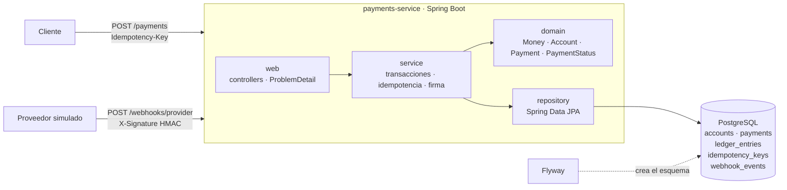
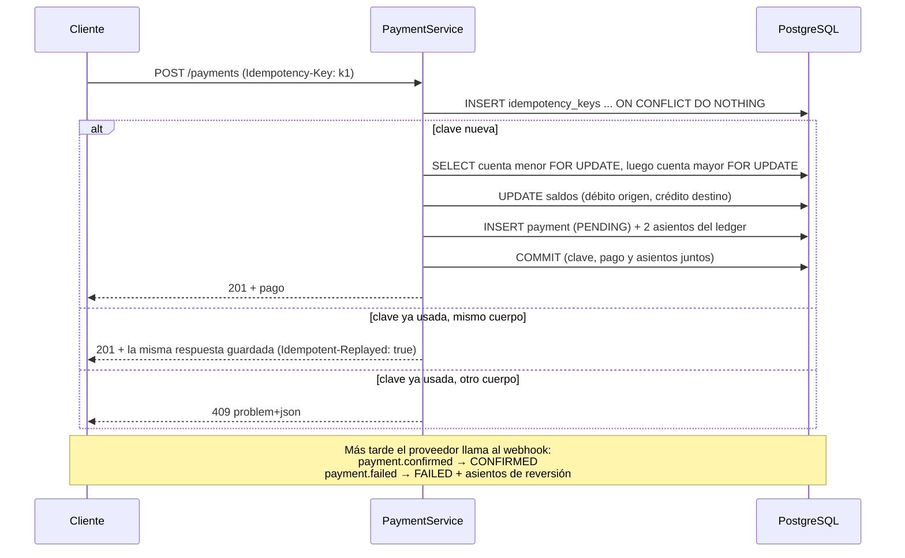

# payments-service

[](https://github.com/Frandercc1234/payments-service/actions/workflows/ci.yml)

> **English summary.** A portfolio-grade payments backend built with Java 21, Spring Boot 3.5, PostgreSQL and Flyway.
> It models accounts with balances in CRC/USD (integer cents, never floating point), creates payments through an
> **idempotent** `POST /payments` (`Idempotency-Key` header), records every movement in an append-only **double-entry
> ledger** (debits and credits always net to zero), prevents overdrafts under concurrency with **pessimistic row
> locks** (50 parallel payments against a balance for 10 → exactly 10 accepted), and processes a simulated provider
> **webhook** verified with **HMAC-SHA256** (constant-time comparison, replays have no effect). Errors follow
> RFC 7807. It is tested against a real PostgreSQL with Testcontainers, runs with a single `docker compose up`,
> and builds/tests on every push with GitHub Actions. **It is a portfolio project: the payment provider is simulated
> and no real money is involved** — see [Límites](#límites).

## Qué resuelve

Los sistemas de pago fallan de formas muy específicas: un cliente reintenta una petición por un corte de red y se cobra
dos veces, dos pagos simultáneos gastan el mismo saldo, un proveedor reenvía una confirmación, alguien falsifica un
webhook. Este servicio es una implementación pequeña y verificable de las defensas contra cada uno de esos problemas:

| Problema | Defensa | Cómo se prueba |
|---|---|---|
| Reintento del cliente cobra dos veces | `Idempotency-Key` + clave única en PostgreSQL | misma clave: mismo resultado; otro cuerpo: 409; 10 peticiones simultáneas: un solo cobro |
| Dos pagos gastan el mismo saldo | `SELECT … FOR UPDATE` (`PESSIMISTIC_WRITE`) | 50 pagos en paralelo contra saldo para 10: exactamente 10 aceptados, saldo ≥ 0 |
| Pagos cruzados A→B y B→A se bloquean entre sí | bloqueo de cuentas en orden fijo de ID | 40 pagos opuestos simultáneos sin deadlocks |
| Dinero que "aparece" o "desaparece" | libro mayor de doble entrada, solo se agregan filas | suma de débitos y créditos = 0, por pago y global |
| Webhook falsificado o alterado | HMAC-SHA256 sobre el cuerpo crudo, comparación en tiempo constante | firma válida, inválida, ausente, malformada, de otro secreto, cuerpo alterado |
| Proveedor reenvía un evento | tabla de eventos con `event_id` único | reenvío (y 10 simultáneos) no cambia nada |
| Estados imposibles (`FAILED` → `CONFIRMED`) | máquina de estados en el dominio | transiciones válidas e inválidas, también vía webhook |

## Arquitectura



Flujo de un pago (todo dentro de **una** transacción):



## Cómo correrlo

Requisitos: **Docker** (con Compose). Para compilar y probar en local: **JDK 21** (el wrapper `mvnw` descarga Maven).

```bash
docker compose up --build
```

Levanta PostgreSQL 16 y la API en `http://localhost:8080` (la API espera a que la base esté sana y Flyway crea el esquema).

| Qué | Dónde |
|---|---|
| Swagger UI | http://localhost:8080/swagger-ui.html |
| OpenAPI JSON | http://localhost:8080/v3/api-docs |
| Salud (Actuator) | http://localhost:8080/actuator/health |

### Probarlo a mano

```bash
# 1) Dos cuentas (montos en CENTAVOS: 100000 = 1.000,00 CRC)
A=$(curl -s -X POST localhost:8080/accounts -H 'Content-Type: application/json' \
  -d '{"ownerName":"Ana","currency":"CRC","initialBalance":100000}' | sed -E 's/.*"id":"([^"]+)".*/\1/')
B=$(curl -s -X POST localhost:8080/accounts -H 'Content-Type: application/json' \
  -d '{"ownerName":"Beto","currency":"CRC","initialBalance":0}' | sed -E 's/.*"id":"([^"]+)".*/\1/')

# 2) Un pago idempotente: repetir este comando devuelve el MISMO pago y no vuelve a cobrar
curl -si -X POST localhost:8080/payments -H 'Content-Type: application/json' -H 'Idempotency-Key: demo-1' \
  -d "{\"sourceAccountId\":\"$A\",\"destinationAccountId\":\"$B\",\"amount\":25000,\"currency\":\"CRC\"}"

# 3) Confirmación del proveedor (simulado): firmar el cuerpo EXACTO con el secreto compartido
PAYMENT_ID=<id devuelto en el paso 2>
BODY="{\"eventId\":\"evt-1\",\"type\":\"payment.confirmed\",\"paymentId\":\"$PAYMENT_ID\"}"
SIG=$(printf '%s' "$BODY" | openssl dgst -sha256 -hmac "dev-only-secret-change-me" -hex | sed 's/^.* //')
curl -s -X POST localhost:8080/webhooks/provider -H 'Content-Type: application/json' \
  -H "X-Signature: sha256=$SIG" -d "$BODY"
```

El secreto de desarrollo viene de `.env.example` (copiarlo a `.env` para cambiarlo; `.env` está ignorado por git).

### Pruebas

```bash
cd payments-service
./mvnw verify     # 70 pruebas; las de integración levantan PostgreSQL real con Testcontainers (requiere Docker)
```

| Tipo | Qué cubre |
|---|---|
| Unitarias de dominio | estados válidos/inválidos, montos positivos, saldo insuficiente, moneda distinta, desbordamiento de `long` |
| Integración (Testcontainers) | esquema y restricciones `CHECK` de la base, flujo de pago, ledger balanceado, formato de error, OpenAPI |
| Idempotencia | misma clave/mismo cuerpo, otro cuerpo (409), orden de campos JSON, clave ausente, intento fallido no consume la clave, 10 simultáneas |
| Concurrencia | 50 pagos en paralelo contra saldo para 10 (×5 repeticiones, con un hilo vigilando que el saldo nunca sea negativo); 40 pagos opuestos sin deadlock |
| Webhook | firma válida / inválida / ausente / malformada / de otro secreto / cuerpo alterado, reenvío, 10 entregas simultáneas, reversión, transiciones inválidas |

> La prueba de concurrencia fue validada con una mutación: al quitar `@Lock(PESSIMISTIC_WRITE)` las 6 pruebas de esa clase
> fallan. Es decir, la prueba detecta de verdad la condición de carrera.

## Endpoints

| Método y ruta | Descripción | Respuestas |
|---|---|---|
| `POST /accounts` | Abre una cuenta (`CRC` o `USD`, saldo inicial en centavos) | 201, 400 |
| `GET /accounts/{id}` | Consulta una cuenta | 200, 404 |
| `POST /payments` | Crea un pago. **Requiere** `Idempotency-Key` | 201, 400, 404, 409, 422 |
| `GET /payments/{id}` | Consulta un pago | 200, 404 |
| `POST /webhooks/provider` | Evento del proveedor. **Requiere** `X-Signature: sha256=<hex>` | 200 (`processed` / `duplicate`), 400, 401, 404, 409, 422 |

Todos los errores salen como `application/problem+json` (RFC 7807) con `type`, `title`, `status` y `detail`
(más `errors[]` en validaciones). Ejemplo:

```json
{
  "type": "urn:payments:problem:insufficient-funds",
  "title": "Saldo insuficiente",
  "status": 422,
  "detail": "Saldo insuficiente en la cuenta 6f1c…"
}
```

## Decisiones clave

Cada decisión incluye la alternativa que se descartó y por qué.

1. **Montos como `long` en centavos.**
   *Descartado:* `double` (no representa 0,10 exactamente) y `BigDecimal` (correcto, pero innecesario si la unidad mínima es fija).
   Además Jackson se configura para **rechazar** `10.5` en un monto en lugar de truncarlo a `10` en silencio, y las sumas usan `Math.addExact`.

2. **Bloqueo pesimista de filas (`SELECT … FOR UPDATE`) y orden fijo de bloqueo.**
   *Descartado:* bloqueo optimista con `@Version` y reintentos. Es válido, pero bajo contención sobre una misma cuenta (el caso de las
   50 peticiones) produce una avalancha de reintentos; con bloqueo pesimista cada pago espera su turno y el resultado es determinista.
   Las cuentas se bloquean siempre por ID ascendente para que A→B y B→A no se bloqueen mutuamente (deadlock).

3. **Idempotencia respaldada por la base de datos.** La clave se reclama con `INSERT … ON CONFLICT DO NOTHING` en la misma transacción que crea el pago.
   *Descartado:* `if (existe) … else insertar` en Java (tiene una carrera entre el `SELECT` y el `INSERT`), una caché en memoria (se pierde al reiniciar y
   no funciona con varias instancias) y Redis (agrega una pieza de infraestructura fuera del stack acordado). La huella del cuerpo se calcula sobre los campos
   interpretados, no sobre el texto, así que el orden de los campos JSON no importa. Un intento **fallido** hace rollback también de la clave: no queda consumida.

4. **Esquema con Flyway y `ddl-auto=validate`.** Las restricciones `CHECK (balance >= 0)`, `CHECK (amount > 0)` y las claves únicas viven en la base:
   son la última defensa aunque el código tuviera un bug.
   *Descartado:* `ddl-auto=update`, que modifica el esquema sin control de versiones ni revisión.

5. **Ledger de doble entrada de solo-agregar.** Cada pago escribe un débito y un crédito; una reversión escribe dos asientos nuevos (`REVERSAL`).
   *Descartado:* actualizar o borrar filas para "deshacer" un pago, que destruye la trazabilidad.

6. **Webhook: HMAC-SHA256 sobre los bytes crudos del cuerpo, comparación en tiempo constante y firma verificada antes de interpretar nada.**
   *Descartado:* deserializar a objeto y volver a serializar para firmar (cualquier diferencia de espacios o de orden invalida una firma legítima) y comparar con `equals`
   (el tiempo de respuesta delata cuántos bytes coinciden).

7. **El dinero se mueve al crear el pago (queda `PENDING`); el proveedor confirma o rechaza después.** Un rechazo revierte con asientos compensatorios.
   *Descartado:* mover el dinero solo al confirmar, que obligaría a modelar reservas/retenciones (*holds*) y complicaría el requisito de que cada pago produzca su débito y crédito.
   El costo de esta decisión está explicado en [Límites](#límites).

8. **Arquitectura por capas simples (`web → service → repository`, con `domain`).**
   *Descartado:* arquitectura hexagonal completa; para este tamaño agrega ceremonia (puertos, adaptadores, mapeos) sin beneficio visible.
   Un compromiso consciente: las entidades JPA viven en `domain` en lugar de duplicarse en un modelo de dominio puro más un modelo de persistencia.

9. **Pruebas contra PostgreSQL real con Testcontainers.**
   *Descartado:* H2 en memoria. No implementa igual `FOR UPDATE`, `ON CONFLICT` ni los niveles de aislamiento, justo lo que se quiere probar.

10. **Un solo servicio.** Las notificaciones como segundo servicio con mensajería quedaron fuera de esta versión a propósito (fase opcional); un broker
    cambia el stack acordado y merece una decisión aparte.

## Límites

Esto es un **proyecto de portafolio**, no un sistema listo para producción. Sin rodeos:

- **El proveedor de pagos es simulado.** El "proveedor" es un cliente que firma con un secreto compartido. **No hay dinero real**, ni tarjetas, ni cumplimiento PCI-DSS, ni conciliación bancaria.
- **No hay autenticación ni autorización.** Cualquiera puede crear cuentas y pagar desde cualquier cuenta. Las claves de idempotencia no están ligadas a un cliente.
- **La reversión necesita fondos en el destino.** Como el dinero se mueve al crear el pago, si el destino ya lo gastó, un `payment.failed` responde 422 y el pago sigue `PENDING`
  (nada queda a medias y el proveedor puede reintentar). Un sistema real modelaría retenciones (*holds*), saldos disponibles vs. contables o un proceso de recuperación (*clawback*).
- **Sin conversión de monedas.** Un pago solo ocurre entre cuentas de la misma moneda (`CRC` o `USD`); lo contrario responde 422.
- **Webhook sin protección contra reenvío por tiempo.** Los duplicados se detectan por `eventId`, pero no hay marca de tiempo firmada ni rotación de secretos.
- **Las claves de idempotencia nunca caducan** (no hay TTL ni limpieza) y solo se guardan los resultados exitosos.
- **El ledger es de solo-agregar por convención del código**, no por permisos de la base (no hay triggers ni un rol de base de datos sin `UPDATE`/`DELETE`).
- **Escalabilidad no demostrada.** El bloqueo por fila serializa los pagos de una misma cuenta (una cuenta muy activa es un cuello de botella). Las pruebas de concurrencia corren contra una sola
  instancia de la aplicación; con varias instancias la corrección se apoya en la base de datos, pero eso no está probado aquí. Hay un único PostgreSQL, sin réplicas.
- **Observabilidad mínima:** solo `/actuator/health`; sin métricas, trazas ni limitación de tasa (*rate limiting*).
- **Configuración de desarrollo:** `docker-compose.yml` expone PostgreSQL en el puerto 5432 con contraseña por defecto y el secreto del webhook tiene un valor de desarrollo. No usar así fuera de una máquina local.
- **Versión de Spring Boot:** el proyecto usa Spring Boot **3.5.16**, la última línea 3.x, tal como se pidió. Spring Initializr ya solo ofrece la línea 4.x, así que migrar es el siguiente paso natural.
- **No hay listados ni paginación**, ni historial de cuentas, ni endpoint para consultar el ledger (se verifica en las pruebas con SQL).

## Estructura

```
docker-compose.yml                 orquesta los servicios (hoy: payments-service + PostgreSQL)
.env.example                       valores de desarrollo
docs/guia-de-estudio.md            guía para entender y explicar cada pieza (con comparación con NestJS)
payments-service/                  proyecto Maven independiente (Dockerfile y mvnw propios)
  src/main/java/cr/portfolio/payments/
    domain/       Money, Account, Payment, PaymentStatus, LedgerEntry, … (reglas de negocio)
    repository/   interfaces de Spring Data JPA (+ consultas con bloqueo)
    service/      PaymentService, IdempotentPaymentService, WebhookService, AccountLocks, SignatureVerifier
    web/          controllers, DTOs y ApiExceptionHandler (ProblemDetail)
    config/       propiedades del webhook y OpenAPI
  src/main/resources/db/migration/   migraciones Flyway
  src/test/java/…                    pruebas unitarias y de integración (Testcontainers)
```
